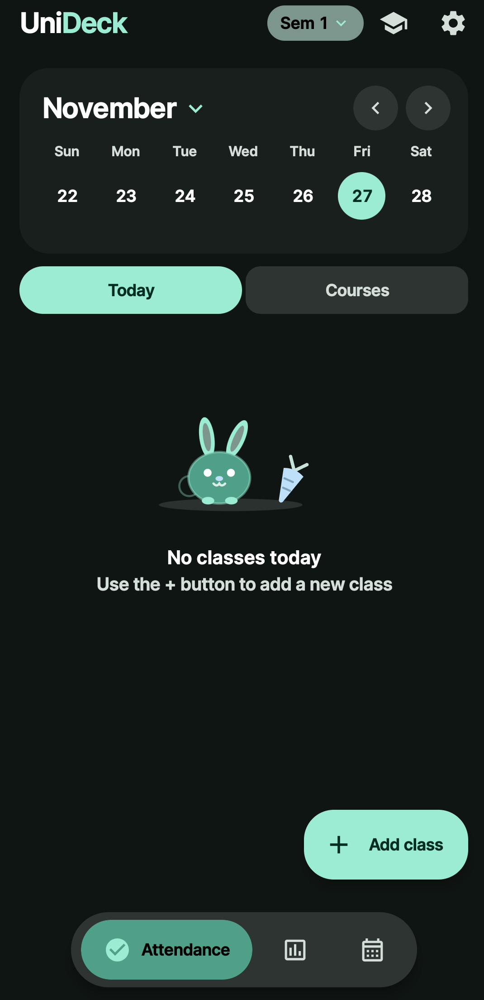
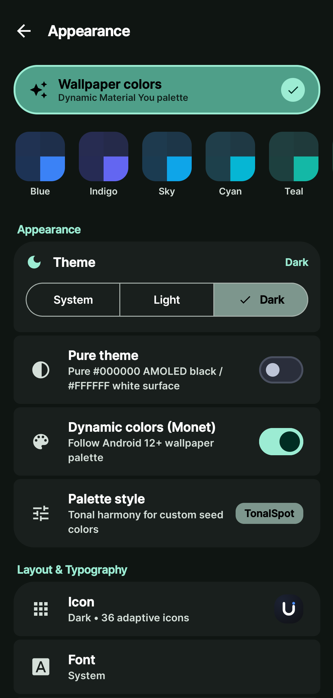
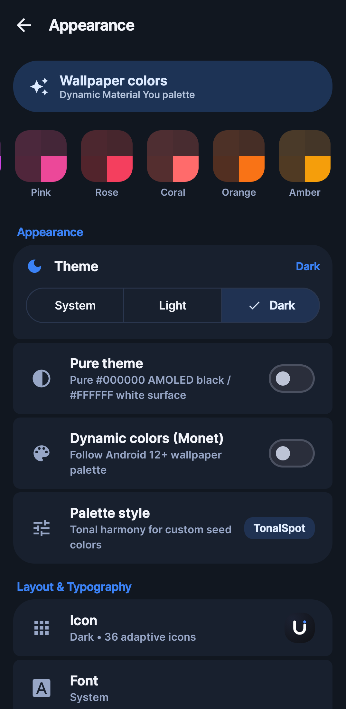
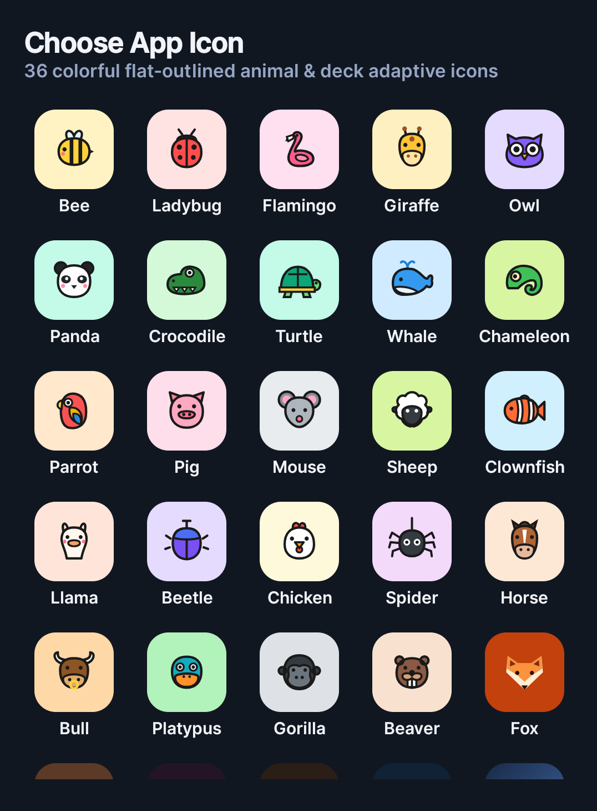
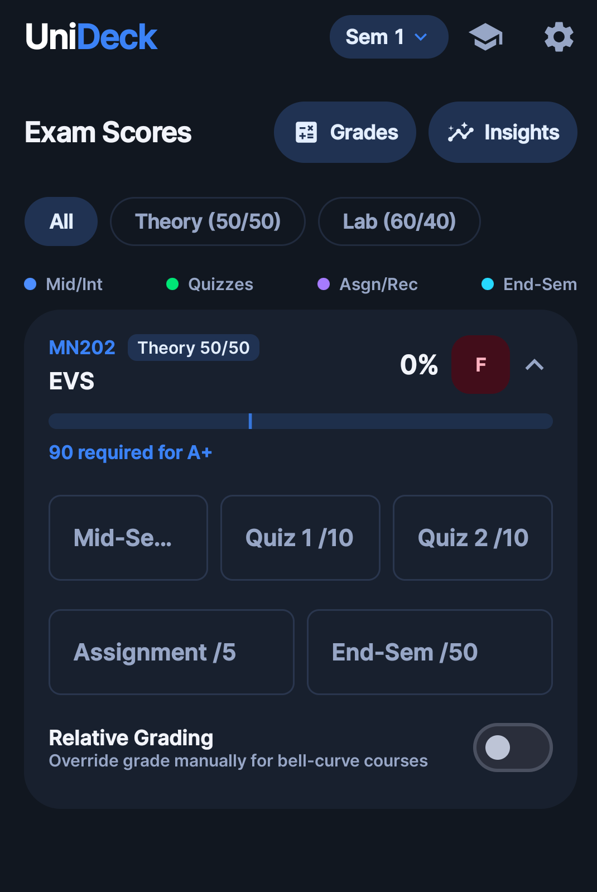
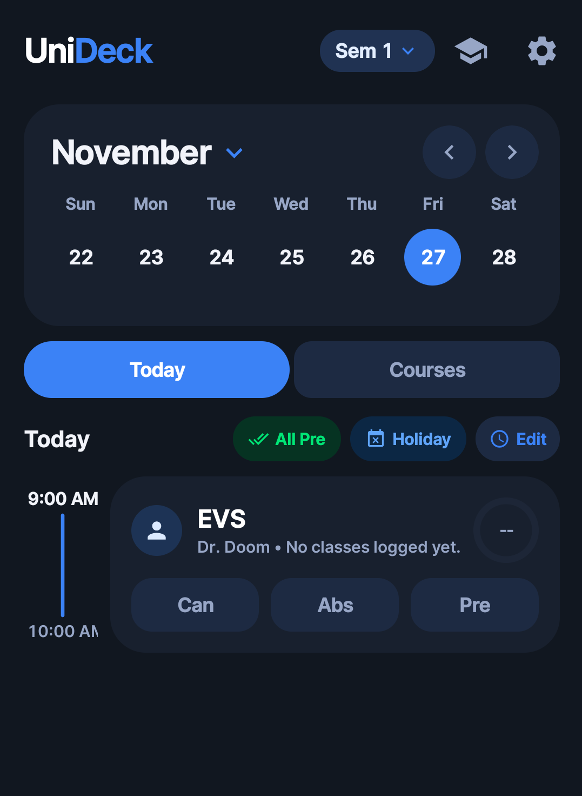

<div align="center">

# UniDeck

**Offline-first academic companion for Android, built with Kotlin, Jetpack Compose, and Material 3.**

[](https://developer.android.com)
[](https://kotlinlang.org)
[](https://developer.android.com/jetpack/compose)
[](https://github.com/r4hullit69/unideck-v3/releases/latest)

[Download APK](https://github.com/r4hullit69/unideck-v3/releases/latest) · [Features](#features) · [Architecture](#architecture) 
</div>

---

## Overview

UniDeck is a local-first university utility built for fast, distraction-free tracking of daily schedules, attendance thresholds, internal assessments, and semester GPA. All data is persisted on-device via Room and Jetpack DataStore with zero external servers, accounts, or telemetry.


---

## Disclaimer

* **AI-Assisted ("Vibecoded") Project:** UniDeck is an independent, non-commercial student project built through AI-assisted ("vibecoded") development. While tested for daily personal use, it is provided **"as is"** without warranty of any kind—please take regular backups via **Settings → Backup & Restore**.
* **No Affiliation:** This project is **not affiliated with, endorsed by, or connected to `unideck.app`** or any other product, service, or trademark sharing a similar name. The `com.unideck.app` package identifier and project name are used strictly for a free, open-source personal utility. If you represent `unideck.app` and have any trademark or naming concerns, please open an issue on this repository and the project name/package ID will be updated promptly.


---
## Previews

<p align="center">
  
  
  
</p>
<p align="center">
  
  
  
</p>


## Features

### Attendance & Daily Timeline
* **Interactive Timeline:** Gesture-driven `Sun–Sat` week/month navigation with contextual quick actions (`All Pre`, `Holiday`, `Edit`) and tactile haptic feedback.
* **Bunk & Recovery Projections:** Subject-level attendance analytics with real-time safe-miss and recovery calculations (`AcademicCalculator`) that respect semester boundaries and holiday overrides.
* **Exact Reminders & Widgets:** Reboot-persistent class reminders via `AlarmManager` (`BootCompletedReceiver`) alongside home screen widgets for Next Class, Today's Schedule, and Academic Snapshot.

### Grades & Fractional-Credit GPA
* **Assessment Logging:** Track quizzes, labs, mid-semester, and end-semester scores per course.
* **SGPA / CGPA Engine:** Full support for fractional course credits (`1.5`, `2.5`, `3.5`) with target-grade simulation.

### Material 3 Expressive UI
* **Dynamic Theming:** Full Android 12+ Monet wallpaper palette support, curated static accents, optional pure-black dark surfaces, and 36 switchable adaptive launcher icons (`AppIconManager`).
* **Tactile Motion:** Floating pill navigation bar, neutral-at-rest attendance pills with spring push-away physics, and GPU-deferred animations designed for smooth 60fps+ scrolling.
* **Interactive Empty States:** 8 theme-aware, pure-Canvas animated companions (Cat, Sheep, Owl, Frog, Penguin, Bunny, Bee, Duck) with tap-driven state machines for free days and outside-semester dates.

### Portable Backups & Timetable Sharing
* **Full Backups:** Manual JSON/`.unideck` export and import via Android's Storage Access Framework (`BackupManager`), plus automated scheduled backups via `WorkManager` (`DailyBackupWorker`).
* **Zero-Personal-Data Semester Sharing:** Export only the active semester's courses and weekly timetable as a `.unideck` file—stripping all attendance logs, marks, GPA history, and preferences. Recipients can import shared timetables additively without overwriting existing semesters.

---

## Architecture

UniDeck follows a single-activity, unidirectional data flow (UDF) architecture in Jetpack Compose, with Room and DataStore acting as the single source of truth.

| Layer | Implementation |
| :--- | :--- |
| **Language** | Kotlin |
| **UI** | Jetpack Compose, Material 3, custom `Canvas` charts & vector animations |
| **Persistence** | Room (`UniDeckDatabase`, `UniDeckDao`) & Jetpack DataStore (`UserPreferencesRepository`) |
| **Background** | `WorkManager` (`DailyBackupWorker`) & `AlarmManager` (`ReminderScheduler`) |
| **Build & CI** | Gradle Kotlin DSL (`libs.versions.toml`), R8 minification, GitHub Actions (`build-apk.yml`) |

### Project Structure

```text
app/src/main/java/com/unideck/app/
├── backup/          # SAF export/import, timetable sharing, WorkManager daily backups
├── data/
│   ├── local/       # Room entities, DAOs, and database configuration
│   ├── prefs/       # DataStore user preferences and theme state
│   └── repository/  # Single source of truth repository layer
├── domain/          # Fractional-credit GPA and attendance projection logic
├── notifications/   # Exact class reminders and boot-completed receivers
├── system/          # Dynamic adaptive launcher icon manager
├── ui/
│   ├── components/  # Custom Canvas charts, companions, timeline cards, haptics
│   ├── screens/     # Attendance, Timetable, Grades, Analytics, Settings
│   └── theme/       # Material 3 dynamic color schemes and typography
└── widget/          # Android home screen widgets
